 

 

## 📊 Habilidades (autoavaliação sincera)

## 🧰 Ferramentas do dia a dia

## 🙋 Perguntas frequentes

👇 Clica numa pergunta pra ver a resposta.

<b>"É só um botãozinho, coisa rápida."</b>

 
Nunca é só um botãozinho. Mas eu faço mesmo assim.

<b>"Dá pra fazer igual ao Uber, só que pra padaria?"</b>

 
Dá. Só não me pergunta o prazo agora.

<b>"Você trabalha sozinho?"</b>

 
Digamos que eu tenho uma equipe muito eficiente. 😏

<b>"Qual foi o bug mais difícil que você já resolveu?"</b>

 
Um ponto e vírgula. Três horas. Não quero falar sobre isso.

<b>"Modo claro ou modo escuro?"</b>

 
Tem modo claro?

<b>"Você já apagou um banco de dados em produção?"</b>

 
Próxima pergunta.

## 👾 Contribuições (sendo devoradas)

<picture>
  <source media="(prefers-color-scheme: dark)" srcset="https://raw.githubusercontent.com/LMK30013/LMK30013/output/pacman-contribution-graph-dark.svg" />
  
</picture>

 

Nenhum banco de dados foi apagado na criação deste perfil. Dessa vez.

<!-- Se você abriu o código-fonte deste README: sim, eu tive ajuda. Mas quem revisou fui eu. -->
